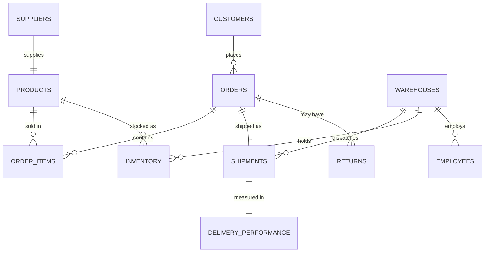

# SwiftLog Logistics: Supply Chain Analytics and Business Intelligence


**AnalystLab Africa Experience Lab Internship | Week 5 | Data Analytics Track**

An end-to-end Business Intelligence solution built in Power BI for **SwiftLog Logistics Limited**, a fast-growing Nigerian logistics company. The project turns 11 raw datasets into a five-page interactive dashboard, a set of business insights, and a list of data-backed recommendations.

---

## Table of Contents

1. [Project Overview](#1-project-overview)
2. [Business Objectives](#2-business-objectives)
3. [Tools and Skills](#3-tools-and-skills)
4. [Datasets](#4-datasets)
5. [Data Model](#5-data-model)
6. [Data Cleaning and Transformation](#6-data-cleaning-and-transformation)
7. [KPIs and DAX Measures](#7-kpis-and-dax-measures)
8. [Dashboard Pages](#8-dashboard-pages)
9. [Interactive Features](#9-interactive-features)
10. [Key Findings](#10-key-findings)
11. [Business Recommendations](#11-business-recommendations)
12. [Data Notes and Limitations](#12-data-notes-and-limitations)
13. [Repository Structure](#13-repository-structure)
14. [How to Use This Project](#14-how-to-use-this-project)
15. [Author](#15-author)

---

## 1. Project Overview

SwiftLog operates warehouses, suppliers, inventory systems, shipment tracking and nationwide delivery services. Rapid growth has led to delayed deliveries, inventory imbalances, supplier inconsistencies, product returns and limited visibility for management.

As a Junior Data Analyst at AnalystLab Africa Consulting, my task was to design a Business Intelligence solution that lets management monitor performance, find bottlenecks and make faster, data-driven decisions.

**Scope of the data:** 5,000 orders (1 January to 8 September 2026), 1,000 customers in four cities (Lagos, Abuja, Kano, Ibadan), 250 products in three categories (Fashion, Food, Electronics), 15 warehouses and 150 suppliers.

## 2. Business Objectives

- Monitor business performance
- Improve delivery efficiency
- Reduce operational costs
- Improve inventory management
- Evaluate supplier performance
- Improve warehouse operations
- Reduce product returns
- Support executive decision-making

## 3. Tools and Skills

| Tool | Purpose |
|---|---|
| Power BI Desktop | Data modelling, DAX, dashboards and interactivity |
| Power Query | Data import, cleaning and transformation |
| DAX | KPIs and business measures |
| PowerPoint | Executive presentation |
| GitHub | Version control and portfolio |

**Skills demonstrated:** data cleaning, data modelling, KPI design, DAX, dashboard design, data storytelling, business recommendations.

## 4. Datasets

| Dataset | Description |
|---|---|
| SwiftLog_Customers | Customer ID, name and city |
| SwiftLog_Orders | Order ID, customer, order date and order status |
| SwiftLog_Order_Items | Order line items with product and quantity |
| SwiftLog_Products | Product ID, category, unit price and supplier key |
| SwiftLog_Suppliers | Supplier ID, name and supplier key |
| SwiftLog_Warehouses | Warehouse ID and location |
| SwiftLog_Inventory | Stock by warehouse and product |
| SwiftLog_Shipments | Shipments by order and warehouse |
| SwiftLog_Delivery_Performance | Delivery status and delay days per shipment |
| SwiftLog_Employees | Employees by warehouse |
| SwiftLog_Returns | Return ID, order and return reason |
| SwiftLog_Data_Dictionary.xlsx | Field definitions and relationships |

## 5. Data Model

The model connects 11 tables through key columns, with orders, shipments and inventory acting as the central links.



| From (many side) | To (one side) | Key | Cardinality |
|---|---|---|---|
| Orders | Customers | CustomerID | Many to one |
| Order_Items | Orders | OrderID | Many to one |
| Order_Items | Products | ProductID | Many to one |
| Inventory | Products | ProductID | Many to one |
| Inventory | Warehouses | WarehouseID | Many to one |
| Shipments | Orders | OrderID | One to one |
| Shipments | Warehouses | WarehouseID | Many to one |
| Delivery_Performance | Shipments | ShipmentID | One to one |
| Employees | Warehouses | WarehouseID | Many to one |
| Returns | Orders | OrderID | Many to one |
| Suppliers | Products | SupplierKey | One to one |


## 6. Data Cleaning and Transformation

All transformations were done in **Power Query** and are recorded in each table's Applied Steps.

| Step | Detail |
|---|---|
| Import | Loaded all 11 CSV files into Power BI |
| Headers | Promoted the first row to headers in every table |
| Data types | Set IDs and text fields as Text, quantities and prices as numbers, and order date as Date |
| Text cleaning | Trimmed leading and trailing spaces from ID and name columns |
| Date fields | Created Order Year, Month Name, Order Month and Order Quarter from the order date |
| Date table | Added date hierarchy fields (Year, Month, Quarter, Day) for time-based analysis |
| Model design | Linked tables with one-to-many and one-to-one relationships to form a clean relational model |

### Data dictionary for added fields

| Table | Field | Description |
|---|---|---|
| Orders | OrderYear | Year extracted from the order date |
| Orders | Month Name | Month name extracted from the order date |
| Orders | OrderMonth | Month number extracted from the order date |
| Orders | OrderQuarter | Quarter (Qtr 1 to Qtr 4) derived from the order date |
| Date table | Year, MonthNo, Month, QuarterNo, Quarter, Day | Standard calendar fields for time-series visuals |

## 7. KPIs and DAX Measures

The model contains **16 custom DAX measures**.

| Measure | DAX | Business value |
|---|---|---|
| Total Revenue | `SUMX(Order_Items, Order_Items[Quantity] * RELATED(Products[UnitPrice]))` | Shows total sales performance |
| Total Orders | `DISTINCTCOUNT(Orders[OrderID])` | Tracks business volume |
| Total Customers | `DISTINCTCOUNT(Customers[CustomerID])` | Measures the size of the customer base |
| Customers With Orders | `DISTINCTCOUNT(Orders[CustomerID])` | Shows how many customers are active buyers |
| Total Products | `DISTINCTCOUNT(Products[ProductID])` | Shows catalogue size |
| Total Shipments | `DISTINCTCOUNT(Shipments[ShipmentID])` | Tracks logistics activity |
| Average Order Value | `DIVIDE([Total Revenue], [Total Orders], 0)` | Shows how much a typical order is worth |
| Average Delivery Delay | `AVERAGE(Delivery_Performance[DelayDays])` | Shows how late deliveries run on average |
| On-Time Delivery Rate | `DIVIDE(CALCULATE(DISTINCTCOUNT(ShipmentID), Status = "On Time"), DISTINCTCOUNT(ShipmentID), 0)` | Key service quality measure |
| Total Delayed Shipments | `CALCULATE(DISTINCTCOUNT(ShipmentID), Status = "Delayed")` | Counts shipments needing attention |
| Inventory Stock Level | `SUM(Inventory[Stock])` | Shows total units held |
| Total Units in Stock | `SUM(Inventory[Stock])` | Used in inventory cards and charts |
| Inventory Turnover | `DIVIDE(SUM(Order_Items[Quantity]), SUM(Inventory[Stock]), 0)` | Shows how fast stock moves (low means overstock) |
| Average Stock per Product | `DIVIDE(SUM(Inventory[Stock]), DISTINCTCOUNT(Inventory[ProductID]), 0)` | Helps spot over- and under-stocked products |
| Inventory Records | `COUNTROWS(Inventory)` | Counts warehouse and product stock records |
| Total Warehouses | `DISTINCTCOUNT(Warehouses[WarehouseID])` | Shows network size |

### Headline KPI results

| KPI | Result |
|---|---|
| Total Revenue | 21,668,066 |
| Total Orders | 5,000 |
| Total Customers | 1,000 |
| Total Products | 250 |
| Total Shipments | 5,000 |
| Average Order Value | 4,333.61 |
| On-Time Delivery Rate | 36.28% |
| Delayed Shipments | 3,186 |
| Average Delivery Delay | 3.57 days |
| Inventory Stock Level | 1,007,764 units |
| Inventory Turnover | 0.08 |
| Return Rate | 10.0% (500 returns on 5,000 orders) |

## 8. Dashboard Pages

The report has **five interactive pages**.

### 8.1 Executive Summary
KPI cards (Total Revenue, Total Orders, Total Customers, Average Order Value, On-Time Delivery Rate), Revenue by Month, Orders by Month, Revenue by Category, Shipment by Status, with City and Quarter slicers.


### 8.2 Customer Analysis
Top Customers by Revenue, Top Customers by Orders, Customer Distribution by City, Orders by City, Customer Growth Trend and Revenue by Category.


### 8.3 Inventory and Warehouse Analysis
Inventory Level by Product, Stock by Warehouse Location, Products with Lowest Stock, Stock Comparison by Location, and cards for Total Units in Stock, Inventory Turnover, Average Stock per Product and Inventory Records.


### 8.4 Shipment and Delivery Analysis
Delivery Status Distribution, Delayed Shipments by Status, Delivery Performance by Location, Shipment Volume Trend, Shipments by Location and Status, and cards for Total Shipments, Delayed Shipments and Average Delivery Time.


### 8.5 Supplier and Product Analysis
Top 10 Best-Selling Products, Revenue by Product, Product Revenue vs Quantity Sold, Product Price Comparison, Revenue by Category, and cards for Total Units Sold, Average Unit Price and Products Sold.


## 9. Interactive Features

| Feature | How it is used |
|---|---|
| Page navigation buttons | Move between the five pages from any page |
| Slicers and synced filters | City, Quarter, Category, Location and Status slicers filter related pages together |
| Cross-filtering | Selecting a bar or slice filters every other visual on the page |
| Dynamic report titles | Chart titles change with the selected city |
| Conditional formatting | On-Time Delivery Rate turns red or green against a 50% target |
| Drill-through | Right-click a customer to open a Customer Detail page |
| Dynamic tooltips | Hovering over a chart opens a custom tooltip page |
| Bookmarks | Buttons switch between saved views (for example Lagos View and All Cities) |
| What-If parameter | A Target On-Time % slider shows the gap to the delivery target |
| Mobile layout | KPI cards and key charts arranged for phone screens |

## 10. Key Findings

1. **Products and revenue:** Fashion leads (8.06M, 37.2%), followed by Food (7.11M) and Electronics (6.50M). The top five products make up only 4.2% of revenue, so sales are well spread.
2. **Customers:** The top 100 customers (10% of the base) bring in 22.1% of revenue. Kano is the highest-earning city (5.68M). Ibadan has the most customers but the lowest spend per customer.
3. **Warehouses:** W01 (Abuja), W10 (Kano) and W07 (Lagos) are the most punctual. W05, W09 and W03 are the weakest. Staffing is uneven, from about 20 to 38 shipments per employee.
4. **Suppliers:** Only two of 150 suppliers reach 50% on-time delivery. Suppliers 85 and 65 combine good delivery with low return rates, while Suppliers 60, 73, 47 and 104 are the weakest.
5. **Returns:** About 10% of orders are returned. Reasons are Late Delivery (37%), Wrong Item (32.6%) and Damaged (30.4%). P032 and P040 have the highest return rates.
6. **Delays by region:** Lagos has the most delayed shipments (1,701, or 53% of all delays), but all regions are close to 62 to 64% delayed, so the problem is network-wide.
7. **Peak months:** August 2026 is the peak (626 orders, 2.85M revenue), followed by April and May. Quarter 2 is the strongest quarter.
8. **KPIs needing attention:** On-time delivery (36.3%), order status mix (only 33% delivered, 34% pending and 32.5% cancelled), average delay (3.57 days), return rate (10%) and inventory turnover (0.08).
9. **Inefficiencies:** Systemic late delivery, stalled or cancelled orders, stock about 12 times recent demand, uneven staffing and avoidable returns.
10. **Opportunities:** Loyalty programme for top customers, higher spend in Ibadan, growth in Fashion, better stock planning for peak months and supplier performance management.

## 11. Business Recommendations

| # | Area | Recommendation |
|---|---|---|
| 1 | Delivery optimization | Keep a weekly delay root-cause log and set an on-time target, starting with Lagos |
| 2 | Logistics optimization | Review Lagos routes, dispatch times and carriers, and copy practices from Kano |
| 3 | Warehouse efficiency | Audit W05, W09 and W03 and share the methods used at W01, W10 and W07 |
| 4 | Warehouse staffing | Rebalance headcount toward W14, W15 and W12 |
| 5 | Inventory management | Set reorder points and move surplus stock to low-stock sites |
| 6 | Supplier improvement | Introduce quarterly supplier scorecards and improvement plans for the weakest suppliers |
| 7 | Supplier quality | Inspect products and suppliers with the highest return rates |
| 8 | Return reduction | Add pick-and-pack checks and improve packaging |
| 9 | Cost reduction | Investigate cancelled and pending orders and stop handling effort on cancelled orders |
| 10 | Customer retention | Launch a loyalty programme for the top 100 customers |
| 11 | Business growth | Promote top Fashion products, lift spend in Ibadan and stock up before peak months |
| 12 | Performance monitoring | Add cancellation rate, staffing ratio and supplier on-time rate to the dashboard and review weekly |

**Suggested targets** (illustrative, based on current volume): raise on-time delivery from about 36% to 50% (roughly 680 fewer late shipments) and reduce returns from 10% to 8% (roughly 100 fewer returns).

## 12. Data Notes and Limitations

- Revenue is calculated as quantity multiplied by unit price and includes Pending and Cancelled orders.
- 236 of 5,000 orders have no line items, and 9 customers have no orders.
- Three inventory rows are exact duplicates, and they are included in the dashboard stock total.
- 100 of the 250 products have no matching supplier record, so supplier findings cover about 60% of revenue.
- Warehouse locations are limited to Lagos, Abuja and Kano, so "region" means warehouse location.
- Order data ends on 8 September 2026, so September is incomplete.
- The currency is not stated in the source data, so revenue is shown as plain numbers.

## 13. Repository Structure

```
Week5_DataAnalytics_SwiftLog_Meenah/
├── Data/                      Original datasets (11 CSV files and data dictionary)
├── Dashboard/
│   └── SwiftLog_Analytics.pbix
├── Report/
│   ├── Executive_BI_Report.pdf
│   └── Dashboard_Screenshots.pdf
├── Presentation/
│   └── Executive_Presentation.pptx
├── Images/                    Dashboard and data model screenshots
├── References/
└── README.md
```

## 14. How to Use This Project

1. Download or clone this repository.
2. Open `Dashboard/SwiftLog_Analytics.pbix` in **Power BI Desktop**.
3. If Power BI shows a data source error, go to **Home > Transform data > Data source settings**, choose **Change Source**, and point each file to the matching CSV in the `Data` folder.
4. Click **Refresh**, then explore the five pages using the navigation buttons and slicers.

## 15. Author

**Adeyemo Taiwo Aminat (Meenah)**
Junior Data Analyst, AnalystLab Africa Experience Lab
Lagos, Nigeria

- LinkedIn: _add your profile link_
- X (Twitter): _add your handle_
- GitHub: _add your username_

Project completed as part of the **AnalystLab Africa Experience Lab Internship (Week 5)**. `#AnalystLabAfrica`
